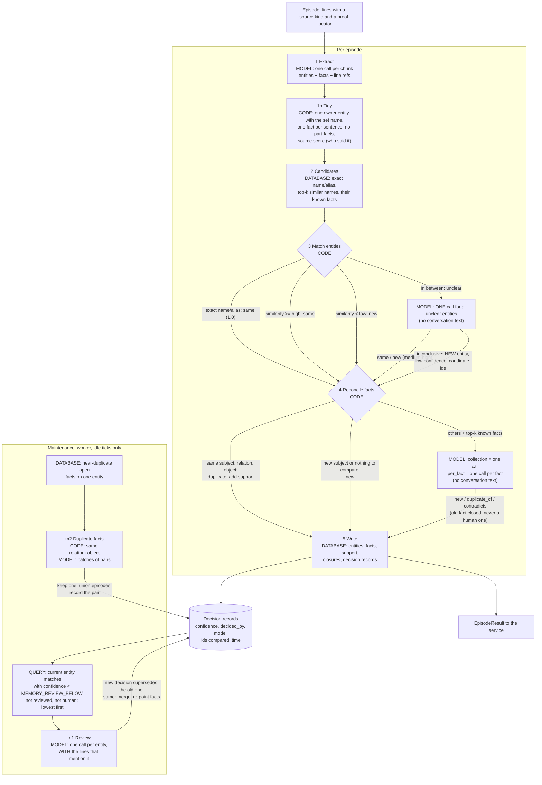

# Staged knowledge engine (`MEMORY_ENGINE=staged`)

Same port as the `graphiti` engine (`engine/base.py`), with our own explicit pipeline. Each
line of an episode goes to the model exactly once. No earlier conversation is ever sent. Every
decision is a stored record with a confidence score.

## Files, in reading order

| File | What it does |
|---|---|
| `pipeline.py` | `StagedEngine`. `add_episode` lists the five stages in order; `maintain` runs m1 then m2; the rest of the port. |
| `types.py` | The dataclasses passed between stages (lines, extraction, stored entity/fact/episode, decisions). |
| `s1_extract.py` | Model: chunk the lines by a character budget, one call per chunk, merge by normalised name. |
| `s1b_tidy.py` | Code: every name for the user is one entity (`MEMORY_OWNER_NAME`); a sentence given for several pairs is one fact; a fact that repeats a part of a longer one is dropped; each fact gets a source score. |
| `s2_candidates.py` | Database: candidate stored entities (exact + similar) with a few known facts each. |
| `s3_match_entities.py` | Code decides clear cases; one model call for all unclear entities. |
| `s4_reconcile_facts.py` | Code finds exact duplicates; the model judges the rest (collection or per_fact). |
| `s5_write.py` | Database: writes everything, records decisions, returns the `EpisodeResult`. |
| `m1_review_uncertain.py` | Maintenance: deeper review of low-confidence entity matches, found by query. |
| `m2_merge_duplicate_facts.py` | Maintenance: merge near-duplicate facts of one entity. |
| `erase.py` | `remove_episode`: takes out everything only that episode said (facts, words, names, decisions). |
| `confidence.py` | Every confidence number, and the read-time fact confidence. |
| `prompts.py` | All prompts and JSON schemas. |
| `llm.py` | OpenAI-compatible JSON client with per-stage counters; `FakeLLM` for tests. |
| `store.py` | `GraphStore` protocol and `MemoryGraphStore` (in-process, tests and demos). |
| `store_neo4j.py` | `Neo4jGraphStore`: the same data in Neo4j, in Graphiti's node/edge shape. |
| `settings.py`, `factory.py` | Settings from the environment; building the engine. |

## Confidence

Scores come from how a decision was made, not from a number the model invents
(`confidence.py`):

| How | Score |
|---|---|
| exact name or alias | 1.0 |
| no stored entity alike | 1.0 |
| similarity >= `SAME_ABOVE` (same) | 0.8 at the threshold, up to 1.0 |
| similarity < `NEW_BELOW` (new) | 0.7 just under the threshold, up to 1.0 |
| fact rule (identical signature, or nothing to compare) | 1.0 |
| model same / new / duplicate / contradicts | `MEMORY_STAGED_MODEL_CONFIDENCE` (0.75) |
| ... when the model gives its certainty | high 0.85, medium 0.7, low 0.45 |
| model inconclusive, or an unusable answer | 0.3 |
| deeper review decided (same / distinct) | 0.9 |
| deeper review inconclusive | 0.4 (not asked again) |
| human | 1.0, never reviewed |
| who said it: the owner or a recognised speaker | 1.0 |
| who said it: only speakers with an unknown role (a person in the room, or a TV) | 0.5 |

- A decision is never changed. A later one (review, human) supersedes it in the same chain
  (`root`, `supersedes`); the newest of a chain is the current one.
- "Uncertain" is not stored. It is a current entity-match decision with
  `confidence < MEMORY_REVIEW_BELOW`.
- A fact's own score is the minimum of its reconcile decision and "who said it" (its best
  line counts). With `MEMORY_MIN_CONFIDENCE=0.6`, facts heard only from unknown speakers are
  left out of `facts()` and `search()`; they stay stored, and a later episode where a known
  speaker says the same raises the score.
- A fact's confidence (`EngineFact.confidence`, a new optional field; other engines leave it
  `None`) is computed when read: the minimum of the fact's own score, the match
  decisions that linked its subject and object in that episode, and the decisions that created
  those two entities. Resolving an entity therefore changes its facts' scores without rewriting
  them.
- Decision field meanings follow the ledger's `Link` record: `key`, `decided_by`,
  `policy_version`, `model`, `confidence`. The `key` is a digest (`textutil.digest`), never
  clear text. Each decision names the `episode_id` it came from (a review keeps its root's).
- A decision chain missing at read time counts as 1.0 (`MISSING_DECISION`): erase deletes a
  chain only when nothing reads it, so this is only old data or a partial failure, and a missing
  record should not hide a fact; the fact's own score and other decisions still bound it.

## Settings

| Env | Default | Meaning |
|---|---|---|
| `MEMORY_ENGINE` | `graphiti` | `staged` selects this engine |
| `MEMORY_STAGED_STORE` | `neo4j` | `neo4j` or `memory` (tests, demos) |
| `MEMORY_FACT_RECONCILE` | `collection` | `collection`: one reconcile call per episode; `per_fact`: one per fact |
| `MEMORY_OWNER_NAME` | (empty) | the user's name in every fact, e.g. `Stu`; empty = `Owner` |
| `MEMORY_OWNER_ALIASES` | (empty) | comma list of other names that mean the user (full name, nickname). The speaker label of owner lines counts by itself |
| `MEMORY_STAGED_CHUNK_CHARS` | 6000 | extraction chunk budget (cut at line boundaries) |
| `MEMORY_STAGED_SAME_ABOVE` | 0.93 | name similarity at or above: same entity, no model |
| `MEMORY_STAGED_NEW_BELOW` | 0.80 | name similarity below: new entity, no model |
| `MEMORY_STAGED_ENTITY_TOP_K` | 5 | similar stored entities per new entity |
| `MEMORY_STAGED_CANDIDATE_FACTS` | 5 | known facts shown per candidate entity |
| `MEMORY_STAGED_FACT_TOP_K` | 5 | known facts of the subject compared with a new fact |
| `MEMORY_STAGED_MODEL_CONFIDENCE` | 0.75 | score of a decided model answer without certainty |
| `MEMORY_REVIEW_BELOW` | 0.6 | entity matches below this are reviewed by maintenance |
| `MEMORY_MIN_CONFIDENCE` | 0 | `facts()` and `search()` leave out machine facts below this |
| `MEMORY_STAGED_DUP_ABOVE` | 0.90 | facts of one entity this similar are a duplicate candidate |
| `MEMORY_STAGED_DUP_BATCH` | 10 | pairs per duplicate-fact model call |
| `MEMORY_MAINTAIN` | true | background maintenance on idle worker ticks |
| `MEMORY_MAINTAIN_BUDGET` | 5 | model calls per maintenance batch |
| `MEMORY_MAINTAIN_INLINE` | false | run one batch after each episode (development, tests) |
| `MEMORY_LLM_BASE_URL`, `MEMORY_LLM_MODEL`, `MEMORY_LLM_API_KEY` | | the model (shared with the other engines); `MEMORY_STAGED_MODEL` overrides the model name |
| `MEMORY_LLM_EXTRA_BODY` | `{}` | JSON merged into every request, e.g. `{"chat_template_kwargs": {"enable_thinking": false}}` |
| `MEMORY_LLM_RESPONSE_FORMAT` | `json_schema` | or `json_object` for servers without structured output |
| `MEMORY_LLM_TIMEOUT_SECONDS` | 600 | per request |
| `MEMORY_EMBED_*`, `MEMORY_NEO4J_*` | | as for the graphiti engine |

Similarity: in Neo4j, cosine of Graphiti's embeddings (raw cosine, -1..1). In
`MemoryGraphStore`, names compare by character sequence and facts by shared words.

## Storage

Neo4j holds Graphiti's shape (`Entity`, `RELATES_TO`, `Episodic`, `MENTIONS`), written with
graphiti-core's own `save` methods, so `engine/graphiti.py` reads it too. Our extra fields are
plain properties on the nodes and edges (`aliases`, `names_norm`, `match_root`, `source_name`,
`target_name`, `confidence`, ...): simpler than a side collection. Decision records are
`StagedDecision` nodes keyed by `group_id`, not linked into the graph. A fact keeps the names
as said in the episode that wrote it, so the service's fact ids (a hash of the names) do not
change when maintenance re-points it to another entity. Maps (`alias_sources`, fact `variants`)
are JSON strings in Neo4j.

## Erase (`remove_episode`, erase.py)

Nothing said only in the removed episode stays:

- **Facts**: each fact keeps every supporting episode's own words (`variants`). The removed
  episode leaves the support list and its words go. A fact it worded switches to a surviving
  episode's words (and is re-embedded); with no support or words left, it is deleted.
- **Names**: every name and alias records the episodes that said it (`name_sources`,
  `alias_sources`); no code path makes an alias without a source, and a merge carries the
  sources over. The removed episode leaves every list; an alias left without a source is
  dropped. If the entity's own name has no source left, it stays only if a surviving fact was
  written with it; else the alias with most sources (or a surviving fact's name) becomes the name.
- **Episode** node and its text (which the review job reads) are deleted; then entities no fact
  points at.
- **Decisions**: the episode's chains (and chains of earlier removed episodes) are deleted,
  except a chain a surviving entity or fact still reads its confidence from.
- `clear(group)` deletes everything of the group, decisions included.

A fact that switches words gets a new service fact id (a hash of its names); its older proofs
no longer match, so the service hides it until it is proved again (a later ingest or a rebuild).

## Counters

`engine.llm.meter` counts per stage (`extract`, `match`, `reconcile`, `review`, `dup_facts`):
calls, input and output tokens (from the server's `usage`), seconds and failures;
`meter.as_dict()` adds a total. `engine.tally` counts decisions by outcome and by rule or model
(e.g. `entities_same_by_rule`, `facts_duplicate_by_rule`, `facts_new_by_model`).
`eval/run_staged.py` writes both to `metrics.json` with confidence bands.
